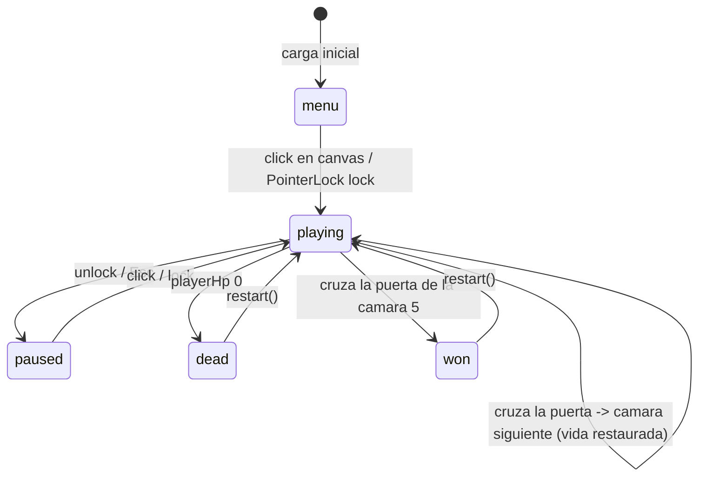
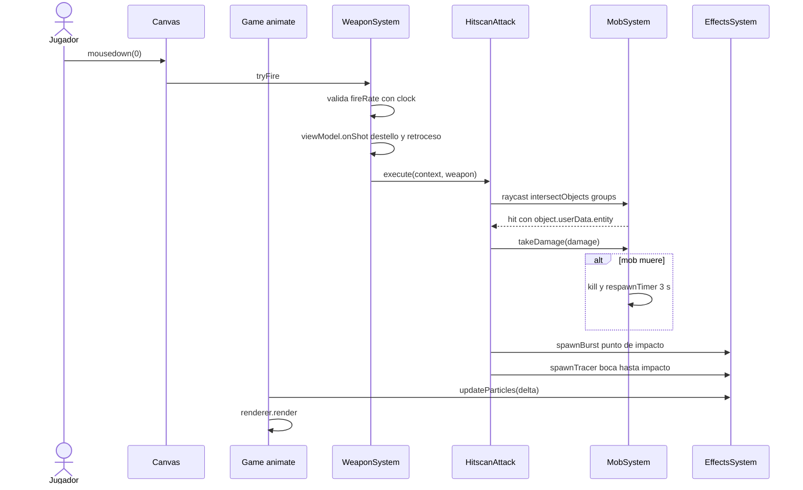
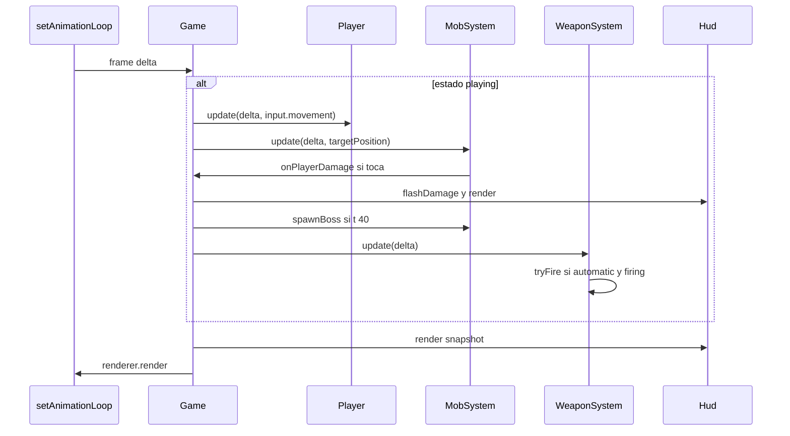
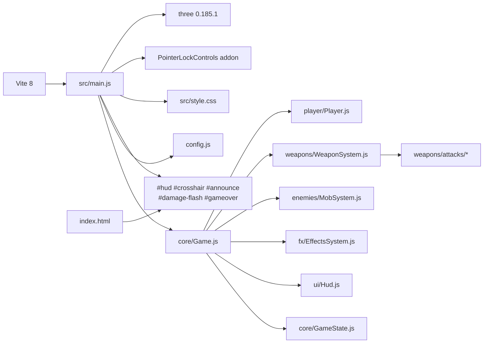

# Arquitectura

El juego esta dividido en modulos ES. Cada archivo tiene una sola
responsabilidad y `src/main.js` solo instancia y conecta (composition root).

```
src/
  main.js                    composition root: instancia y cablea
  config.js                  constantes y tunables
  contracts.js               contratos JSDoc compartidos
  core/     EventEmitter, GameState, Game
  engine/   Arena, SpaceSkybox, createRenderer
            CollisionWorld, textures
  input/    InputController, KeyboardInput, MouseInput
  player/   Player
  weapons/  WeaponCatalog, WeaponFactory, ViewModel, WeaponSystem
            attacks/ HitscanAttack, MeleeAttack
  enemies/  Mob, MobFactory, MobSystem
  fx/       EffectsSystem
  scenes/   Ship (pecio), props (themes), Door (salida)
  ui/       Hud
```

## 1. Como se aplica SOLID

| Principio | Donde se ve |
| --- | --- |
| SRP | `Hud` solo DOM, `Mob` solo vida e IA, `MobSystem` solo ciclo de vida, `Game` solo orden de actualizacion |
| OCP | nuevo modo de disparo = nueva clase en `weapons/attacks`; `WeaponSystem` no cambia |
| LSP | `Mob` cumple el contrato `Target`; el jefe es la misma clase con otra variante (`MOB_VARIANTS.boss`), sin subclases |
| ISP | `InputController` expone `movement`, `firing` y eventos; cada consumidor toma solo lo que usa |
| DIP | `Game` recibe subsistemas por constructor; los ataques reciben un `AttackContext`, no clases concretas |

## 2. Vista de clases

```mermaid
classDiagram
    direction TB

    class Game {
        +update(delta)
        +start()
        +restart()
        +restartFromFirst()
        +endGame(won)
        +onPlayerDamage(amount)
    }

    class GameState {
        +string status
        +number hp
        +number elapsed
        +boolean isPlaying
        +boolean isFinished
        +start()
        +pause()
        +finish(won)
        +damage(amount)
        +reset()
    }

    class CollisionWorld {
        +setStatics(boxes)
        +setDynamic(circles)
        +resolveEnvironment(position, radius, bodyHeight)
        +resolveActors(position, radius)
    }

    class Door {
        +boolean isOpen
        +open()
        +update(delta)
        +contains(position)
        +dispose()
    }

    class Campaign {
        +number unlocked
        +number stageIndex
        +Stage stage
        +boolean isComplete
        +advance()
        +reset()
        +save()
    }

    class Arena {
        +Scene scene
        +Box3[] colliders
        +Vector3[] sparkPoints
        +setStage(stage)
        +update(delta)
        +applyPalette(palette)
    }

    class SpaceSkybox {
        +Group group
        +update(delta, elapsed)
    }

    class Player {
        +PerspectiveCamera camera
        +number bobPhase
        +Vector3 origin
        +reset()
        +update(delta, axis)
        +forward()
        +lock()
        +unlock()
    }

    class WeaponSystem {
        +string currentKey
        +WeaponDef current
        +select(key)
        +cycle(direction)
        +tryFire()
        +update(delta)
        +setTargets(targets)
    }

    class WeaponDef {
        <<datos>>
        +string label
        +number damage
        +number fireRate
        +boolean automatic
        +number range
        +string attack
        +Vector3 muzzle
        +number flashScale
        +number recoilPush
        +number swingPush
    }

    class AttackStrategy {
        <<interface>>
        +string id
        +execute(context, weapon)
    }

    class HitscanAttack {
        +string id
        +execute(context, weapon)
    }

    class MeleeAttack {
        +string id
        +execute(context, weapon)
    }

    class ViewModel {
        +Group holder
        +onSwitch(key)
        +onShot(weapon)
        +muzzleWorldPosition()
        +update(delta, bobPhase, elapsed)
    }

    class Mob {
        +Object3D group
        +MobVariant variant
        +number hp
        +boolean isAlive
        +takeDamage(amount)
        +kill()
        +reset(position)
        +updateDead(delta)
        +update(delta, context)
    }

    class MobFactory {
        <<module>>
        +createMobModel(variant) : MobModel
        +registerEntity(group, entity)
    }

    class MobModel {
        <<value>>
        +Object3D group
        +Object parts
        +Material[] materials
        +animate(delta, state)
    }

    class MobSystem {
        +Mob[] targets
        +boolean bossSpawned
        +number kills
        +update(delta, context)
        +setStage(stage, playerPosition)
        +spawnBoss(playerPosition)
        +randomSpawnPosition(playerPosition, minDistance)
    }

    class EffectsSystem {
        +spawnBurst(position, count, speed, hex)
        +spawnTracer(from, to)
        +spawnShipDestructionBurst(position)
        +setSparkEmitters(points)
        +update(delta)
    }

    class Ship {
        +Vector3[] sparkPoints
        +update(delta)
    }

    class Hud {
        +render(snapshot)
        +announce(text, seconds)
        +updateAnnounce(delta)
        +flashDamage()
        +damageNumber(amount)
        +setCrosshair(active)
        +showGameOver(overview)
        +hideGameOver()
        +onRestart(handler)
        +onRestartFromFirst(handler)
    }

    class InputController {
        +MovementAxis movement
        +boolean firing
        +on(event, handler)
    }

    class KeyboardInput
    class MouseInput
    class EventEmitter

    Game *-- GameState : consulta
    Game *-- Campaign : progreso
    Game o-- Player : mueve
    Game o-- WeaponSystem : actualiza
    Game o-- MobSystem : actualiza
    MobSystem *-- Mob : crea y reubica
    Mob ..> MobFactory : pide modelo y animacion
    Game o-- EffectsSystem : actualiza
    Game o-- SpaceSkybox : anima
    Game o-- CollisionWorld : consulta colliders
    Game o-- Door : abre y cruza
    Game o-- Arena : monta stages y props
    Arena o-- PropScene : decorado por theme
    Arena ..> Ship : pecio del theme hangar
    EffectsSystem ..> PropScene : chispas en sparkPoints
    Game o-- Hud : dibuja
    Game --> InputController : consulta
    Arena *-- Player : aloja camera
    WeaponSystem o-- HitscanAttack : estrategia
    WeaponSystem o-- MeleeAttack : estrategia
    WeaponSystem --> ViewModel : feedback
    WeaponSystem ..> Mob : apunta a objetivos
    WeaponSystem ..> EffectsSystem : pide efectos
    HitscanAttack ..> Mob : takeDamage
    InputController *-- KeyboardInput
    InputController *-- MouseInput
    KeyboardInput ..> EventEmitter
    MouseInput ..> EventEmitter
```



## 3. Maquina de estados de la partida



## 4. Secuencia: disparo con arma de fuego



## 5. Secuencia: ciclo de `Game.update()`



## 6. Dependencias



## Enemigos

`MobFactory` construye el modelo procedural a partir de la variante y devuelve
`{ group, parts, materials, animate }`. Cada enemigo recibe materiales propios:
compartirlos hacia que el destello de impacto de uno se viera en todos.

- Los modelos miran hacia `-Z`, por eso `Mob` calcula el yaw a mano
  (`Math.atan2(-x, -z)`) en lugar de usar `lookAt`, que apunta a `+Z`.
- `animate(delta, state)` solo mueve las piezas; la IA sigue en `Mob`, que le
  pasa `moving` y `attacking`. Las animaciones parten de una pose base, asi que
  un enemigo que se detiene vuelve a la postura.
- El brillo de los ojos se guarda al crear el enemigo y se restaura tras el
  destello y al reaparecer, de modo que no se pierde ni queda en negro.
- Las variantes normales (`soldier`, `alien`, `tank`) se reparten por turno
  entre los `MOB.count` enemigos; el jefe es siempre `boss`.
- **Navegacion**: `Mob` no camina en linea recta contra los props. Antes de
  moverse sondea hacia delante varios puntos (`CollisionWorld.isBlocked`) y,
  si la recta esta tapada, prueba giros cada vez mayores (`NAV_OFFSETS`). El
  lado de giro (`#turnSign`) se fija al aparecer para no oscilar. Si todo esta
  tapado avanza de frente y la colision lo desliza.
- **Fin de la camara**: al caer el jefe, `MobSystem` retira los normales que
  quedaban (`#removeNormals`) y desactiva su reaparicion; solo queda el jefe
  inerte y la puerta. Asi se cruza la salida sin enemigos nuevos.

### Proporciones

Las medidas estan en metros y son deliberadas, porque un enemigo mas alto que
la camara (1.7) tapa la escena en vez de amenazar:

| modelo | alto | ancho | lectura |
| --- | --- | --- | --- |
| `soldier` | 1.78 | 0.67 | humano, el tamano de referencia |
| `alien` | 1.94 | 0.66 | el mas alto de los gruntos, delgado |
| `tank` | 1.42 | 1.23 | bajo y ancho, perfil de vehiculo |
| `boss` | 2.82 | 1.35 | imponente, por debajo de los muros (3) |

- Nada de `BoxGeometry` pelado: las placas son `RoundedBoxGeometry` para que las
  aristas cojan luz, y las extremidades son capsulas con hombro y codo.
- Las extremidades cuelgan de un grupo pivote en la cadera o el hombro, asi que
  giran desde la articulacion en vez de deslizarse desde su centro.
- El tanque es intencionadamente bajo: hay que apuntar hacia abajo para
  acertarle, y esa es su diferencia de silueta con los demas.

## Colisiones

No hay motor de fisicas: `CollisionWorld` corrige posiciones en el plano del
suelo (X,Z) contra dos tipos de geometria:

- **Estaticas** (`Box3`): estructura de la nave (paneles, vigas) y el decorado
  de la camara. Cajas por encima de la cabeza o mas bajas que un escalon
  (`STEP_HEIGHT`) no bloquean.
- **Dinamicas** (circulos): los enemigos vivos, publicados por `MobSystem`
  cada frame para que el jugador no los atraviese.

`Arena` y cada decorado exponen `colliders`; `Game` los vuelca al mundo en cada
`setStage`. El jugador y los mobs empujan contra el entorno; los mobs se
separan entre si para no apilarse. `isBlocked` es la version consultiva de la
colision: no corrige nada, solo responde si un cuerpo cabe en un punto, y es
la que usa la IA para esquivar. Sin mundo (pruebas o ausencia), `Player` cae
al clamp simple anterior.

## Decorado por themes

Cada camara tiene un theme (`hangar`, `depot`, `reactor`, `crucible`, `core`).
`Arena` solo monta el entorno fijo (piso, muros, techo, rejilla, estructura);
`props.js` construye el decorado propio de la etapa y devuelve
`{ colliders, sparkPoints, update, dispose }`. Al cambiar de camara se libera
el decorado anterior y se monta el nuevo: por eso cada escenario se ve
distinto, no solo con otra paleta.

Las texturas de piso, muro y metal se generan en canvas (`textures.js`) con
base clara para que `material.color` las tine con la paleta de la etapa. Son
singletons compartidos, asi el recambio de camara no regenera canvases.

## Pecio: nave estrellada

`Ship` es el decorado del theme `hangar`. Construye un
fuselaje partido contra el muro del fondo (con costillas y una brecha), vigas
caidas, chatarra repartida en anillo y una nacela de motor reventada. Todo se
apoya en los muros o se aleja del centro (`radio >= 4.5`) para no tapar el
punto de aparicion del jugador ni su linea de tiro.

- No conoce el juego ni los efectos: solo expone `sparkPoints`, las
  coordenadas de mundo de la brecha y del motor.
- `Game` conecta esos puntos con `EffectsSystem.setSparkEmitters`; sin puntos
  no se generan chispas, asi el sistema de efectos no inventa posiciones.
- Las brasas (materiales `emissive`) parpadean en `Ship.update`; no hay luces
  reales, solo emision, para no encarecer el render.

## Persistencia

El progreso de la campania solo se escribe en `localStorage` cuando el jugador
pulsa F5 (`Campaign.save()`). `advance()` y `reset()` trabajan en memoria: salir
del juego sin guardar descarta el avance, que es el comportamiento pedido.
`KeyboardInput` traduce F5 a `save:press` (con `preventDefault` para frenar la
recarga del navegador); `main.js` escucha el evento y avisa por el HUD.

## Deuda tecnica

- `MobSystem.randomSpawnPosition` se prueba por parametro, pero sigue siendo
  publico: se podria dejar privado y exponer solo `resetAll`.
- El contrato de las armas es un objeto plano (`view`) con cuatro miembros en
  lugar de una clase. Es suficiente, pero no hay comprobacion de tipos.
- `main.js` conoce el orden de actualizacion a traves de `Game`, no de los
  modulos: correcto, pero sigue habiendo un unico punto que hay que leer.
- Sin sombras: el render no activa `shadowMap`, asi que `castShadow` no tiene
  efecto. Las siluetas se leen por contraste de materiales.
- `MeleeAttack` mide el cono contra el origen del enemigo (sus pies), no contra
  su centro de masa. Con un enemigo alto como el jefe hay que apuntar mas bajo
  de lo natural para acertar con el cuchillo.
- Las colisiones aproximan cada prop con su caja orientada al mundo (Box3),
  no con su forma real: un cilindro tumbado colisiona como una caja. Basta
  para el prototipo, pero los bordes no son exactos.
- Tras empujar al jugador fuera de un enemigo no se revalida contra las cajas
  de nuevo; se hace una segunda pasada completa para reducir el clip, no una
  resolucion por eje.
- La gama de props usa geometria simple y compartida: no hay variedad de
  mallas por theme, solo de disposicion. Suficiente para distinguir camaras.
- Sin pruebas en el repositorio: la verificacion se hizo con un script temporal
  de humo sobre `GameState`, `Mob`, `MobSystem`, `WeaponSystem` y los ataques.
