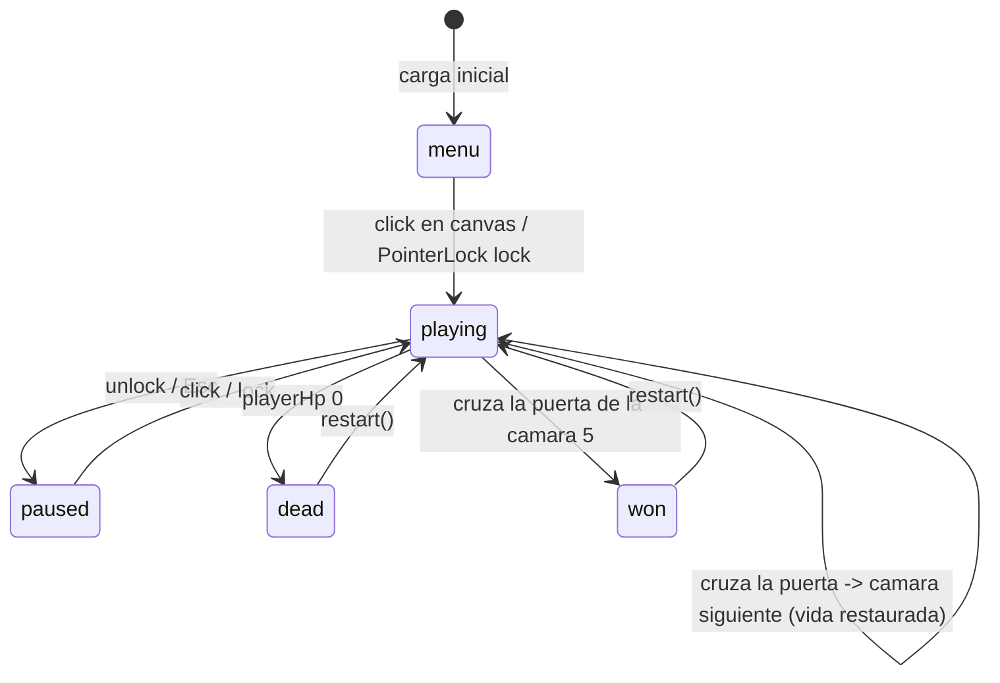
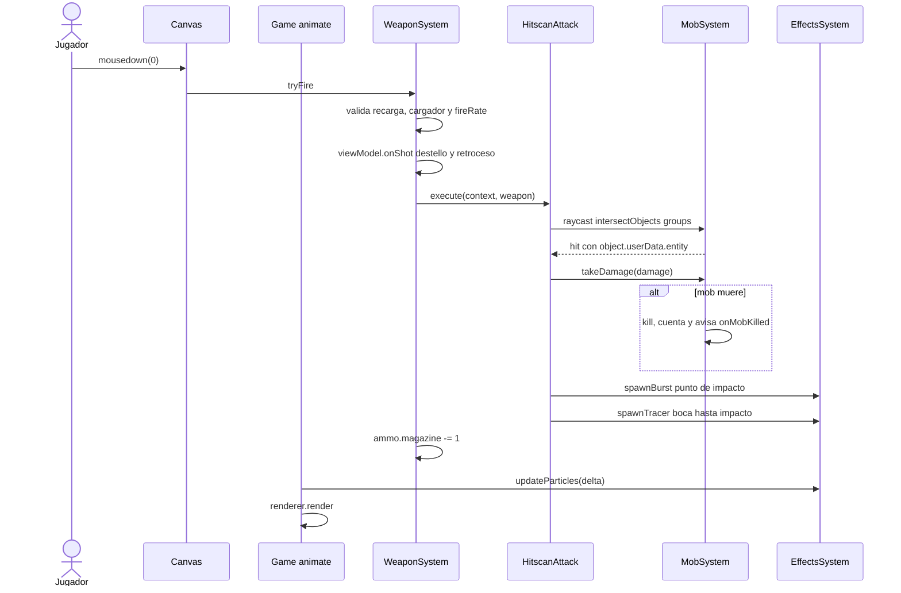
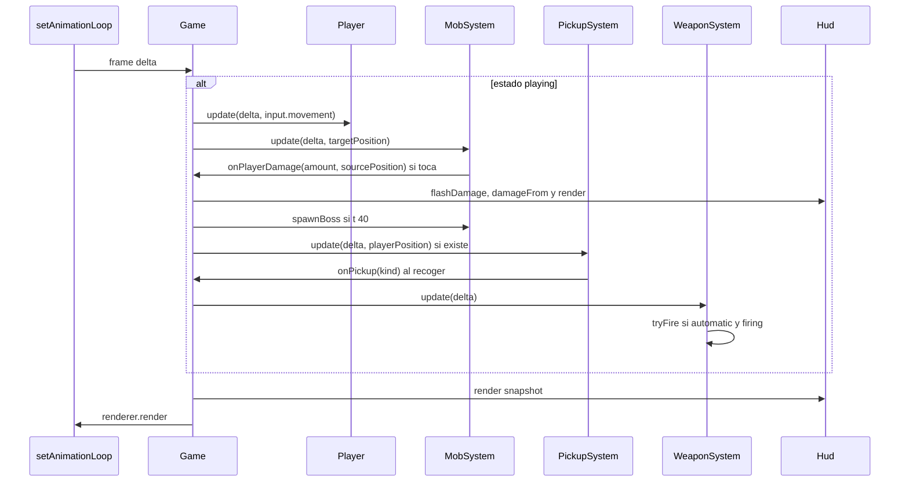

# Arquitectura

El juego esta dividido en modulos ES. Cada archivo tiene una sola responsabilidad y `src/main.js` solo instancia y conecta (composition root).

```
src/
  main.js                    composition root: instancia y cablea
  config.js                  constantes y tunables
  contracts.js               contratos JSDoc compartidos
  core/     EventEmitter, GameState, Game
  engine/   Arena, SpaceSkybox, createRenderer
            CollisionWorld, textures
  input/    InputController, KeyboardInput, MouseInput
  player/   Player
  weapons/  WeaponCatalog, WeaponFactory, ViewModel, WeaponSystem
            attacks/ HitscanAttack, MeleeAttack
  enemies/  Mob, MobFactory, MobSystem
  fx/       EffectsSystem
  scenes/   Ship (pecio), props (themes), Door (salida)
  ui/       Hud
```

## 1. Como se aplica SOLID

| Principio | Donde se ve |
| --- | --- |
| SRP | `Hud` solo DOM, `Mob` solo vida e IA, `MobSystem` solo ciclo de vida, `Game` solo orden de actualizacion |
| OCP | nuevo modo de disparo = nueva clase en `weapons/attacks`; `WeaponSystem` no cambia |
| LSP | `Mob` cumple el contrato `Target`; el jefe es la misma clase con otra variante (`MOB_VARIANTS.boss`), sin subclases |
| ISP | `InputController` expone `movement`, `firing` y eventos; cada consumidor toma solo lo que usa |
| DIP | `Game` recibe subsistemas por constructor; los ataques reciben un `AttackContext`, no clases concretas |

## 2. Vista de clases

```mermaid
classDiagram
    direction TB

    class Game {
        +update(delta)
        +start()
        +restart()
        +restartFromFirst()
        +endGame(won)
        +onPlayerDamage(amount, sourcePosition)
    }

    class GameState {
        +string status
        +number hp
        +number elapsed
        +boolean isPlaying
        +boolean isFinished
        +start()
        +pause()
        +finish(won)
        +damage(amount)
        +heal(amount)
        +reset()
    }

    class CollisionWorld {
        +setStatics(boxes)
        +setDynamic(circles)
        +resolveEnvironment(position, radius, bodyHeight)
        +resolveActors(position, radius)
    }

    class Door {
        +boolean isOpen
        +open()
        +update(delta)
        +contains(position)
        +dispose()
    }

    class Campaign {
        +number unlocked
        +number stageIndex
        +Stage stage
        +boolean isComplete
        +advance()
        +reset()
        +save()
    }

    class Arena {
        +Scene scene
        +Box3[] colliders
        +Vector3[] sparkPoints
        +setStage(stage)
        +update(delta)
        +applyPalette(palette)
    }

    class SpaceSkybox {
        +Group group
        +update(delta, elapsed)
    }

    class Player {
        +PerspectiveCamera camera
        +number bobPhase
        +Vector3 origin
        +reset()
        +update(delta, axis)
        +forward()
        +lock()
        +unlock()
    }

    class WeaponSystem {
        +string currentKey
        +WeaponDef current
        +WeaponAmmoState ammoState
        +select(key)
        +cycle(direction)
        +tryFire()
        +reload()
        +addAmmo(amount)
        +reset()
        +update(delta)
        +setTargets(targets)
    }

    class WeaponDef {
        <<datos>>
        +string label
        +number damage
        +number fireRate
        +boolean automatic
        +number range
        +string attack
        +Vector3 muzzle
        +number flashScale
        +number recoilPush
        +number swingPush
        +number magazine
        +number reserve
        +number maxReserve
        +number reloadTime
    }

    class AttackStrategy {
        <<interface>>
        +string id
        +execute(context, weapon)
    }

    class HitscanAttack {
        +string id
        +execute(context, weapon)
    }

    class MeleeAttack {
        +string id
        +execute(context, weapon)
    }

    class ViewModel {
        +Group holder
        +onSwitch(key)
        +onShot(weapon)
        +muzzleWorldPosition()
        +update(delta, bobPhase, elapsed)
    }

    class Mob {
        +Object3D group
        +MobVariant variant
        +number hp
        +number maxHp
        +Vector3 aimPoint
        +boolean isAlive
        +takeDamage(amount)
        +kill()
        +reset(position)
        +updateDead(delta)
        +update(delta, context)
    }

    class MobFactory {
        <<module>>
        +createMobModel(variant) : MobModel
        +registerEntity(group, entity)
    }

    class MobModel {
        <<value>>
        +Object3D group
        +Object parts
        +Material[] materials
        +animate(delta, state)
    }

    class MobSystem {
        +Mob[] targets
        +Mob boss
        +boolean bossSpawned
        +number kills
        +Function onMobKilled
        +update(delta, context)
        +setStage(stage, playerPosition)
        +spawnBoss(playerPosition)
        +randomSpawnPosition(playerPosition, minDistance)
    }

    class EffectsSystem {
        +spawnBurst(position, count, speed, hex)
        +spawnTracer(from, to)
        +spawnShipDestructionBurst(position)
        +setSparkEmitters(points)
        +update(delta)
    }

    class Ship {
        +Vector3[] sparkPoints
        +update(delta)
    }

    class Hud {
        +render(snapshot)
        +announce(text, seconds)
        +updateAnnounce(delta)
        +flashDamage()
        +damageNumber(amount)
        +damageFrom?(angle)
        +setCrosshair(active)
        +showGameOver(overview)
        +hideGameOver()
        +onRestart(handler)
        +onRestartFromFirst(handler)
    }

    class InputController {
        +MovementAxis movement
        +boolean firing
        +on(event, handler)
    }

    class KeyboardInput
    class MouseInput
    class EventEmitter

    Game *-- GameState : consulta
    Game *-- Campaign : progreso
    Game o-- Player : mueve
    Game o-- WeaponSystem : actualiza
    Game o-- MobSystem : actualiza
    MobSystem *-- Mob : crea y reubica
    Mob ..> MobFactory : pide modelo y animacion
    Game o-- EffectsSystem : actualiza
    Game o-- SpaceSkybox : anima
    Game o-- CollisionWorld : consulta colliders
    Game o-- Door : abre y cruza
    Game o-- Arena : monta stages y props
    Arena o-- PropScene : decorado por theme
    Arena ..> Ship : pecio del theme hangar
    EffectsSystem ..> PropScene : chispas en sparkPoints
    Game o-- Hud : dibuja
    Game --> InputController : consulta
    Arena *-- Player : aloja camera
    WeaponSystem o-- HitscanAttack : estrategia
    WeaponSystem o-- MeleeAttack : estrategia
    WeaponSystem --> ViewModel : feedback
    WeaponSystem ..> Mob : apunta a objetivos
    WeaponSystem ..> EffectsSystem : pide efectos
    HitscanAttack ..> Mob : takeDamage
    InputController *-- KeyboardInput
    InputController *-- MouseInput
    KeyboardInput ..> EventEmitter
    MouseInput ..> EventEmitter
```



## 3. Maquina de estados de la partida



## 4. Secuencia: disparo con arma de fuego



## 5. Secuencia: ciclo de `Game.update()`

