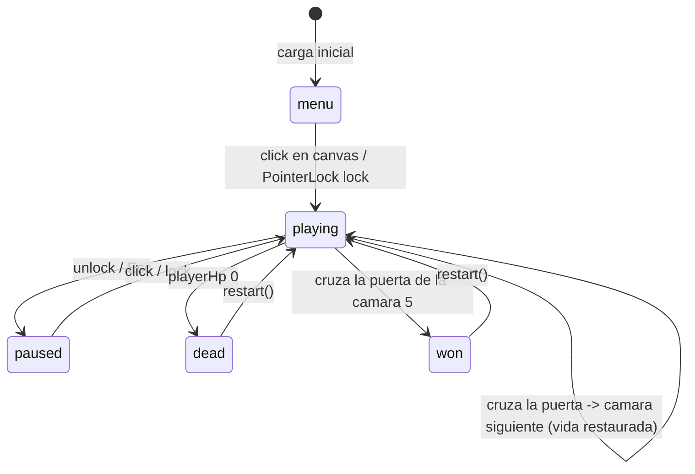

# Game Loop

El bucle principal vive en `src/core/Game.js`. El metodo `update(delta)` se ejecuta cada frame mientras el estado sea `playing`.

## Orden de Actualizacion

```javascript
update(delta) {
  if (this.#state.isPlaying) {
    // 1. Jugador: movimiento, salto, colision con escenario
    this.#player.update(delta, this.#input.movement, this.#input.consumeJump())

    // 2. Enemigos: IA, movimiento, ataque al jugador
    this.#mobs.update(delta, { targetPosition: this.#player.position })

    // 3. Pickups: comprobar recogida por el jugador
    this.#pickups?.update(delta, this.#player.position, {
      onPickup: (kind) => this.#applyPickup(kind)
    })

    // 4. Timer: spawn del jefe a los 40s
    this.#updateTimer(delta)

    // 5. Armas: disparo automatico, recarga, cooldowns
    this.#weapons.update(delta)

    // 6. Jefe derrotado -> abrir puerta
    if (this.#mobs.bossDefeated && !this.#exitReady) this.#openExit()

    // 7. Puerta: animacion y comprobacion de cruce
    if (this.#door) {
      this.#door.update(delta)
      if (this.#door.contains(this.#player.position)) this.#advanceStage()
    }
  }

  // 8. Efectos visuales (siempre)
  this.#effects.update(delta)

  // 9. Arena: props animados, paleta
  this.#arena.update(delta)

  // 10. Skybox: estrellas, planetas
  this.#skybox?.update(delta, this.#clock.elapsedTime)

  // 11. HUD: anuncios, render
  this.#hud.updateAnnounce(delta)
  this.#hud.render(this.#snapshot())
}
```

## Detalle por Subsistema

### Jugador (`src/player/Player.js`)
- Movimiento WASD en plano XZ relativo a la camara
- Salto con fisica simple (velocidad inicial + gravedad)
- Colision con `CollisionWorld` (AABB muros + circulos entidades)
- Head bobbing procedural
- PointerLock para control de raton

### Enemigos (`src/enemies/MobSystem.js`)
- Spawn inicial segun `stage.mobCount`
- IA: persecucion directa + esquiva simple (raycast corto)
- Ataque melee al contacto (cooldown por variante)
- Reaparicion tras muerte (`respawnDelay`)
- Jefe: spawn a los 40s, escolta, stats escalados por etapa

### Armas (`src/weapons/WeaponSystem.js`)
- Gestion de municion (cargador + reserva)
- Fire rate y modo automatico/semiautomatico
- Strategy Pattern: `HitscanAttack` / `MeleeAttack`
- ViewModel: animaciones visuales (recoil, sway, muzzle flash)
- Recarga manual (`R`) o automatica al vaciar

### Colisiones (`src/engine/CollisionWorld.js`)
- Estaticos: AABB (muros, props) via `setStatics()`
- Dinamicos: circulos (jugador, enemigos) via `setDynamic()`
- Resolucion: empuje fuera de solapamiento (no fisica completa)

### Campaña (`src/core/Campaign.js`)
- 5 etapas definidas en `config.js` (`CAMPAIGN.stages`)
- Cada etapa: tema visual, conteo enemigos, stats jefe, paleta
- Progreso persistido en `localStorage` (`fps-azul:campaign`)
- Derrotar jefe -> puerta -> siguiente etapa (vida restaurada)

## Máquina de Estados



## Snapshot para HUD

```javascript
#snapshot() {
  return {
    hp: this.#state.hp,
    maxHp: GAME.maxHp,
    ammo: this.#weapons.ammoState,
    weapon: this.#weapons.currentKey,
    stage: this.#campaign.stage.id,
    totalStages: this.#campaign.total,
    kills: this.#mobs.kills,
    boss: this.#bossSnapshot(),
    elapsed: this.#state.elapsed,
    status: this.#state.status
  }
}
```